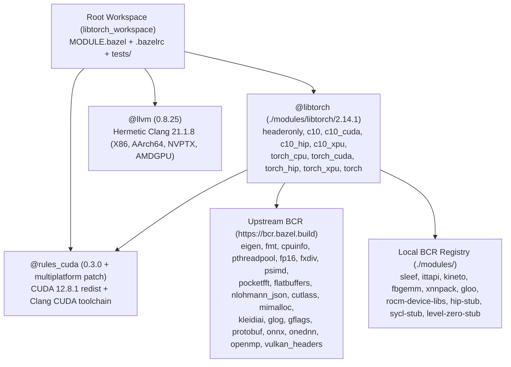

# Engineering Design: Hermetic LibTorch 2.14.1 for Bazel (`@libtorch`)

> **Goal:** Provide a Bazel Central Registry (BCR) module set for **LibTorch 2.14.1**
> ([`pytorch/pytorch@v2.14.1`](https://github.com/pytorch/pytorch/tree/v2.14.1)) that builds
> from source and cross-compiles with [`hermetic-llvm`](https://github.com/hermeticbuild/hermetic-llvm)
> across **Linux, macOS, and Windows** on **`amd64` and `arm64`**, supporting **NVIDIA (`CUDA`)**,
> **AMD (`ROCm/HIP`)**, **Intel (`XPU` + `Vulkan` + `MKLDNN`)**, and **Apple Silicon (`MPS/Metal`)**
> GPUs (plus PyTorch's virtual and out-of-tree plugin accelerator hooks) while remaining 100%
> hermetic in Linux CI via link-time driver/runtime stubs.

### Detailed Phase Documents

- **[PHASE1.md](PHASE1.md):** Workspace Scaffolding, Hermetic Toolchains (`@llvm` + `@rules_cuda`), and `@libtorch` Foundation (`:headeronly` & `:c10`)
- **[PHASE2.md](PHASE2.md):** Hermetic `torchgen` Codegen, Companion CPU Modules (`@sleef`, `@ittapi`), and `@libtorch//:torch_cpu` & `:torch`
- **[PHASE3.md](PHASE3.md):** NVIDIA CUDA Backend (`@libtorch//:c10_cuda` & `@libtorch//:torch_cuda`)
- **[PHASE4.md](PHASE4.md):** Multi-Vendor GPU Backends — AMD (`ROCm/HIP`), Intel (`XPU` & `Vulkan`), Apple (`MPS/Metal`), and Mobile (`NNAPI`)
- **[PHASE5.md](PHASE5.md):** Performance, Quantization, Profiling & Distributed Ecosystem (`@xnnpack`, `@fbgemm`, `@kineto`, `@gloo`)

---

## 1. Motivation & Design Principles

Existing Bazel + PyTorch integrations download official prebuilt `libtorch` archives or invoke CMake via `rules_foreign_cc`. Just as with prebuilt Qt in `qt_bazel_workspace`, prebuilt `libtorch` archives break Bazel's core guarantees:

1. **C++ Standard Library & ABI Mismatch:** Official Linux `libtorch` binaries are compiled with GCC against `libstdc++`, and official Windows binaries are compiled with MSVC against `msvcp140.dll`. Linking them into a hermetic Clang/`libc++` build mixes two C++ standard libraries (`std::__1::` vs. `std::__cxx11::` / MSVC STL) across every `c10::` and `at::` API boundary.
2. **Non-Hermetic GPU & System Dependencies:** Prebuilt GPU archives bundle or expect host-installed CUDA/ROCm/SYCL toolkits and system libraries (`/usr/local/cuda`, `/opt/rocm`, `/opt/intel/oneapi`, system `libgomp`, `libnuma`), preventing reproducible builds and remote execution.
3. **No Cross-Compilation:** A downloaded `libtorch` archive targets a single OS/CPU/GPU combination; cross-compiling from Linux CI to Windows, macOS, or `linux-arm64` is impossible.

### Core Principles (Mirrored from `qt_bazel_workspace`)

- **Built from pristine upstream source tarballs:** `modules/libtorch/2.14.1/source.json` pins the upstream [`v2.14.1.tar.gz`](https://github.com/pytorch/pytorch/archive/refs/tags/v2.14.1.tar.gz) release archive (`sha256-SzSGi6YcJHQN4nontsCcqggtpSGdZ1p96y27zhxas2Y=`) plus a pure Bazel overlay (`BUILD.bazel`, `MODULE.bazel`, `libtorch_config.bzl`).
- **Single hermetic Clang/`libc++` ABI everywhere:** Compiled with `@llvm` (`0.8.25`, LLVM `21.1.8`) across all 6 platforms (`linux-{amd64,arm64}` targeting `glibc 2.34`, `macos-{amd64,arm64}`, and `windows-{amd64,arm64}` targeting MinGW-UCRT).
- **Platform-driven GPU backends (`--platforms`):** The target platform (and optional GPU constraint/flag overrides) selects which GPU backends (`CUDA`, `ROCm/HIP`, `XPU`, `Vulkan`, `MPS`) are compiled and linked.
- **Link-time hardware driver/runtime stubs (`libglvnd` pattern):** Device kernels (PTX/SASS for NVIDIA, AMDGCN code objects for AMD, SPIR-V for Vulkan, Metal shaders for macOS) are compiled hermetically at build time. Host-side hardware driver/runtime DSOs (`libcuda.so.1` / `nvcuda.dll`, `libamdhip64.so` / `amdhip64.dll`, `libsycl.so` / `sycl8.dll`, `libze_loader.so` / `ze_loader.dll`, `libvulkan.so.1` / `vulkan-1.dll`) are linked against symbol-only stub libraries built from source in the action graph and resolved against the host's hardware drivers at runtime (`dlopen` / dynamic loader).

---

## 2. Complete Survey of PyTorch 2.14.1 Hardware Accelerators (`c10::DeviceType`)

In [`torch/headeronly/core/DeviceType.h`](https://github.com/pytorch/pytorch/blob/v2.14.1/torch/headeronly/core/DeviceType.h), PyTorch 2.14.1 defines **21 `c10::DeviceType` enum values** (`COMPILE_TIME_MAX_DEVICE_TYPES = 21`). Every one of them falls into one of four architectural categories in our build:

### 2.1 Category A — In-Tree First-Class Desktop/Server Accelerators

| `DeviceType` | ID | Vendor / Target Hardware | In-Tree Source Directories | How `@libtorch` Builds It |
| :--- | :-: | :--- | :--- | :--- |
| `CPU` | `0` | x86_64 (AVX2, AVX-512, AMX) & ARM64 (NEON, SVE) | `c10/core`, `ATen/cpu`, `ATen/native/cpu`, `ATen/native/kleidiai`, `ATen/native/xnnpack` | Always enabled on all 6 platforms (`:c10`, `:torch_cpu`). Multi-ISA `.cpp.<ISA>.cpp` kernel dispatch + `@sleef`, `@onednn`, `@kleidiai`, `@xnnpack`, `@fbgemm`. |
| `CUDA` | `1` | NVIDIA GPUs (Volta `sm_70` through Hopper/Blackwell `sm_90+`) | `c10/cuda`, `ATen/cuda`, `ATen/native/cuda`, `ATen/cudnn`, `torch/csrc/cuda` | Built into `:c10_cuda` & `:torch_cuda` via `@rules_cuda` (`clang -x cu`, `NVPTX`) + `CUDA 12.8.1` redist + `libcuda.so`/`cuda.lib` stubs on `linux-{amd64,arm64}` & `windows-amd64`. |
| `HIP` | `6` | AMD Instinct (`gfx90a`, `gfx942`) & Radeon (`gfx1100`) GPUs | Hipified from `c10/cuda` & `ATen/{cuda,native/cuda}` + `ATen/miopen` | Built into `:c10_hip` & `:torch_hip` via build-time `hipify_python.py` + `@llvm` native HIP (`clang -x hip`, `AMDGPU`) + `@rocm_device_libs` + `@hip_stub` on `linux-amd64` & `windows-amd64`. |
| `XPU` | `12` | Intel Data Center GPU Max & Intel Arc GPUs | `c10/xpu`, `ATen/xpu`, `ATen/native/mkldnn/xpu`, `ATen/native/transformers/xpu`, `torch/csrc/xpu` | **Key insight:** All in-tree XPU files in `pytorch@v2.14.1` are pure host C++20 calling `<sycl/sycl.hpp>` runtime classes and `LazyLevelZero` (`dlopen("libze_loader.so")`). Built into `:c10_xpu` & `:torch_xpu` with standard `@llvm` Clang 21 against `@sycl_stub` + `@level_zero_stub` + `@onednn`! |
| `MPS` | `13` | Apple Silicon GPUs (M1/M2/M3/M4) | `c10/metal`, `ATen/mps`, `ATen/native/mps`, `torch/csrc/mps` | Built into `:torch_cpu` on `macos_arm64` via `@llvm` Objective-C++ (`-x objective-c++ -fobjc-arc`) against macOS SDK `Metal`, `MetalPerformanceShaders`, and `MetalPerformanceShadersGraph` `.tbd` stubs. |
| `Vulkan` | `10` | Cross-vendor GPU compute (Intel, AMD, NVIDIA, Qualcomm, ARM Mali, MoltenVK) | `ATen/vulkan`, `ATen/native/vulkan` (`glsl/*.glsl`) | Built into `:torch_cpu` on Linux and Windows (`USE_VULKAN=1`, `USE_VULKAN_WRAPPER=1`). Compiles GLSL compute shaders to SPIR-V at build time (`gen_spv.py`) and loads `libvulkan.so.1` / `vulkan-1.dll` dynamically at runtime. |
| `MKLDNN` / `IDEEP` | `2`, `5` | Intel AVX-512 / AMX & ARM Compute Library tensor layouts | `ATen/native/mkldnn` | Built into `:torch_cpu` via `@onednn` (`AT_MKLDNN_ENABLED() = 1`). |

### 2.2 Category B — In-Tree Mobile / Embedded Accelerators

| `DeviceType` | ID | Target Hardware | In-Tree Source Directories | Status in `@libtorch` |
| :--- | :-: | :--- | :--- | :--- |
| `Metal` | `11` | Legacy iOS/macOS mobile Metal backend (predates `MPS`) | `ATen/metal`, `ATen/native/metal` | Context stub (`ATen/metal/Context.cpp`) always compiled into `:torch_cpu`; full mobile shader pipeline gated behind `--@libtorch//:enable_metal_mobile`. |
| `NNAPI` | — | Android Neural Networks API | `ATen/nnapi` | Pure C++ wrapper using `dlopen("libneuralnetworks.so")`; compiled into `:torch_cpu` (zero external dependencies). |
| `OPENGL` / `OPENCL` | `3`, `4` | Legacy mobile GPU enum slots | Enum & `DeviceType.cpp` only | Supported in `c10::DeviceType` dispatch tables; no separate kernel library in upstream 2.14.1. |

### 2.3 Category C — In-Tree Virtual / Compiler Device Types

| `DeviceType` | ID | Purpose | In-Tree Source Directories | Status in `@libtorch` |
| :--- | :-: | :--- | :--- | :--- |
| `Meta` | `14` | Zero-storage shape/stride/dtype inference tensors (required by `torch.compile`, FX, Export) | `ATen/detail/MetaGuardImpl.cpp`, `ATen/native/MetaTensor.cpp`, `RegisterMeta_*.cpp` | **Always enabled** in `:torch_cpu` on all 6 platforms. |
| `Lazy` | `17` | Lazy Tensor Core graph capture (`torch::lazy::LazyTensor`) | `torch/csrc/lazy/**`, `RegisterLazy.cpp` | **Always enabled** in `:torch_cpu` on all 6 platforms (provides the core infrastructure for `XLA` and lazy backends). |

### 2.4 Category D — Out-of-Tree Plugin Accelerators (Hook Interfaces Built into `:torch_cpu`)

PyTorch supports several domain-specific AI accelerators through out-of-tree C++ plugin libraries that register themselves at runtime via `ATen/detail/*HooksInterface.h` or `c10::register_privateuse1_backend()`. By compiling **all** hook interfaces and dispatch keys (`HPU`, `IPU`, `MAIA`, `MTIA`, `XLA`, `VE`, `FPGA`, `PrivateUse1`) into `:torch_cpu`, any downstream plugin can link against `@libtorch` and register its device backend without recompiling LibTorch:

| `DeviceType` | ID | Hardware Accelerator | In-Tree Hook / Support | Out-of-Tree Plugin Ecosystem |
| :--- | :-: | :--- | :--- | :--- |
| `XLA` | `9` | **Google Cloud TPU** (v4, v5e, v5p, v6e Trillium) | `ATen/detail/XLAHooksInterface.{h,cpp}` + `torch/csrc/lazy` | [`pytorch/xla`](https://github.com/pytorch/xla) (`libtorch_xla`) |
| `HPU` | `15` | **Intel Gaudi / Habana** (Gaudi 2, Gaudi 3) | `ATen/detail/HPUHooksInterface.{h,cpp}` | [`HabanaAI/pytorch-integration`](https://github.com/HabanaAI/pytorch-integration) |
| `MTIA` | `19` | **Meta Training and Inference Accelerator** | `ATen/detail/MTIAHooksInterface.{h,cpp}` + `torch/csrc/mtia` | Meta `torch_mtia` runtime plugin |
| `MAIA` | `8` | **Microsoft Maia 100** / ONNX Runtime | `ATen/detail/MAIAHooksInterface.{h,cpp}` | Microsoft ONNX Runtime / Maia plugin |
| `IPU` | `18` | **Graphcore Bow / Colossus IPU** | `ATen/detail/IPUHooksInterface.{h,cpp}` | Graphcore `poptorch` plugin |
| `VE` | `16` | **NEC SX-Aurora TSUBASA** Vector Engine | `c10::DeviceType::VE` dispatch key | `ve-torch` plugin |
| `FPGA` | `7` | **FPGA** accelerators | `c10::DeviceType::FPGA` dispatch key | Vendor FPGA plugins |
| `PrivateUse1` | `20` | **Custom / Vendor AI Accelerators:** - **Huawei Ascend NPU** (`torch_npu`) - **Windows DirectML** (`torch-directml`, incl. `windows-arm64` Qualcomm Snapdragon X Elite NPU/Adreno) - **Cambricon MLU** (`torch_mlu`) - **Moore Threads MUSA** (`torch_musa`) | `ATen/detail/PrivateUse1HooksInterface.{h,cpp}` + `RegisterPrivateUse1_*.cpp` + `c10::register_privateuse1_backend()` | Any vendor plugin using PyTorch's official `PrivateUse1` extension mechanism |

---

## 3. Architecture & Repository Layout

---

## 4. Platform Matrix & `--platforms` Backend Selection

The workspace supports 6 target platforms across 3 OSes and 2 CPU architectures (`x86_64` / `amd64` and `aarch64` / `arm64`). By default, `--platforms` determines the active GPU backends via `select()` in `@libtorch`:

| Target Platform (`--platforms`) | CPU SIMD | NVIDIA (`CUDA`) | AMD (`ROCm / HIP`) | Intel (`XPU` + `OneDNN`) | Cross-Vendor (`Vulkan`) | Apple (`MPS / Metal`) | Virtual & Hook Backends (`Meta`, `Lazy`, `PrivateUse1`, `XLA`, `HPU`, `MTIA`, ...) |
| :--- | :--- | :---: | :---: | :---: | :---: | :---: | :---: |
| `linux_amd64_gnu.2.34` | AVX2 / AVX-512 | **Enabled** (`:c10_cuda`, `:torch_cuda`) | **Enabled** (`:c10_hip`, `:torch_hip`) | **Enabled** (`:c10_xpu`, `:torch_xpu`) | **Enabled** (in `:torch_cpu`) | — | **Enabled** |
| `linux_arm64_gnu.2.34` | NEON / SVE (`kleidiai`) | **Enabled** (`linux-sbsa`) | Opt-in flag | — | **Enabled** (in `:torch_cpu`) | — | **Enabled** |
| `macos_amd64` | AVX2 (`Accelerate`) | — | — | — | — | — | **Enabled** |
| `macos_arm64` | NEON / AMX (`kleidiai`, `Accelerate`) | — | — | — | — | **Enabled** (in `:torch_cpu`) | **Enabled** |
| `windows_amd64` | AVX2 / AVX-512 | **Enabled** (`:c10_cuda`, `:torch_cuda`) | **Enabled** (`:c10_hip`, `:torch_hip`) | **Enabled** (`:c10_xpu`, `:torch_xpu`) | **Enabled** (in `:torch_cpu`) | — | **Enabled** |
| `windows_arm64` | NEON | — | — | — | **Enabled** (in `:torch_cpu`) | — | **Enabled** (incl. `PrivateUse1` for DirectML/NPU) |

---

## 5. Summary of Phased Rollout

| Phase | Document | Key Deliverables |
| :--- | :--- | :--- |
| **Phase 1** | [PHASE1.md](PHASE1.md) | Workspace scaffolding, CI workflows, `@llvm` (`X86`, `AArch64`, `NVPTX`, `AMDGPU`), patched `@rules_cuda` (`12.8.1`), `@libtorch//:headeronly` and `@libtorch//:c10` (`+ :c10_shared`), and Phase 1 smoke tests. |
| **Phase 2** | [PHASE2.md](PHASE2.md) | Local BCR modules `@sleef` and `@ittapi`, hermetic `torchgen` & `gen_autograd` Python codegen rules, multi-ISA CPU kernel compilation, `@libtorch//:torch_cpu` and `@libtorch//:torch` (including `Meta`, `Lazy`, `NNAPI`, and all out-of-tree accelerator hook interfaces). |
| **Phase 3** | [PHASE3.md](PHASE3.md) | `@libtorch//:c10_cuda` and `@libtorch//:torch_cuda` built with `@rules_cuda` (`clang -x cu`) + `@cutlass` `4.2.1` + `CUDA 12.8.1` redistributable stubs across `linux-x86_64`, `linux-sbsa`, and `windows-x86_64`. |
| **Phase 4** | [PHASE4.md](PHASE4.md) | AMD ROCm/HIP (`:c10_hip`, `:torch_hip` via `hipify_python.py` + `clang -x hip` + `@rocm_device_libs` + `@hip_stub`), Intel XPU (`:c10_xpu`, `:torch_xpu` via `@sycl_stub` + `@level_zero_stub` + `@onednn`), Vulkan compute (`USE_VULKAN=1` + `gen_spv.py`), and Apple Silicon `MPS` (`ATen/mps` Objective-C++). |
| **Phase 5** | [PHASE5.md](PHASE5.md) | `@xnnpack`, `@fbgemm` (with `@asmjit`), `@kineto`, and `@gloo` local BCR modules; quantized operators, Kineto GPU/CPU profiler, `c10d` distributed collectives, sanitizer suites, and BCR upstreaming readiness. |
