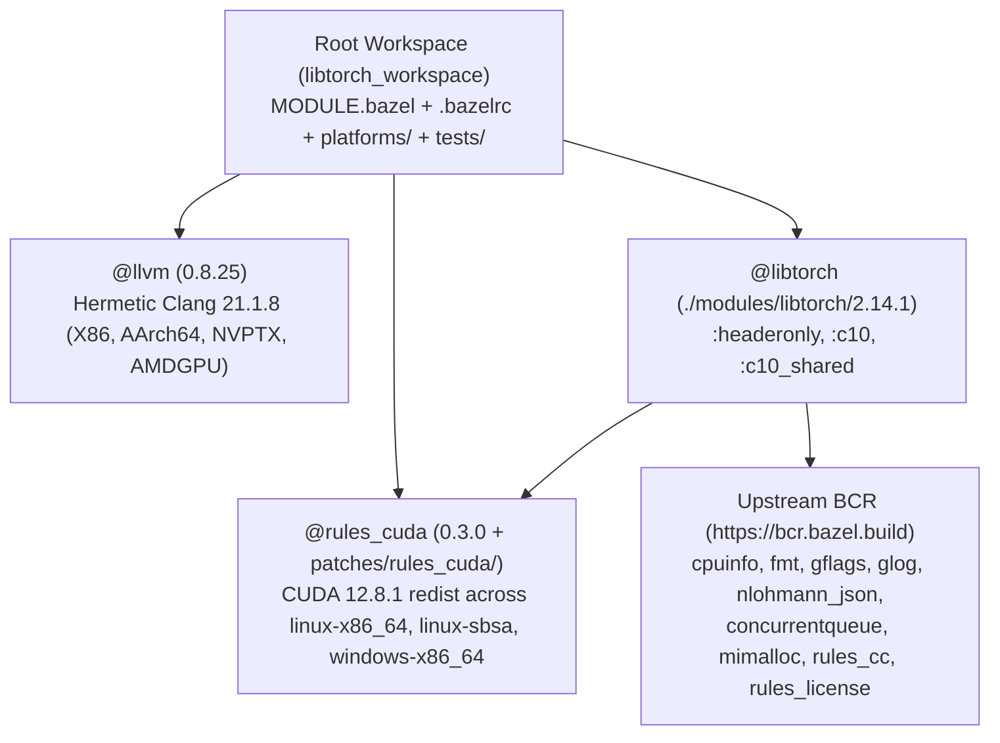

# PHASE 1: Workspace Scaffolding, Hermetic Toolchains (`@llvm` & `@rules_cuda`), and `@libtorch` Foundation (`:headeronly` & `:c10`)

> **Status:** Ready for execution. Establishes the local BCR registry layout (`bazel_registry.json` + `modules/`), the $6 \times 6$ multi-OS/CPU toolchain configuration (`@llvm` `0.8.25` + patched `@rules_cuda` `0.3.0`), the `@libtorch` `2.14.1` module overlay, and the foundational `@libtorch//:headeronly` and `@libtorch//:c10` (`+ :c10_shared`) libraries with cross-platform smoke tests.

---

## 1. Architecture & Layering



Following `qt_bazel_workspace`, the build is organized into four clean layers with **zero modifications to tracked upstream PyTorch source files**:

1. **Local BCR Registry (`./modules/<name>/<version>/` + `bazel_registry.json`):**
   - Served via `.bazelrc` (`common --registry=file:///%workspace%/` ahead of `common --registry=https://bcr.bazel.build`).
   - Uses standard BCR layout (`metadata.json`, `<version>/MODULE.bazel`, `<version>/source.json`, `<version>/presubmit.yml`, `<version>/overlay/BUILD.bazel`) with `@rules_license` metadata so every module can be upstreamed directly to the Bazel Central Registry.
2. **Hermetic Cross-Compiling C++ & GPU Toolchains (`@llvm` + `@rules_cuda`):**
   - `@llvm` `0.8.25` (`llvm_version = "21.1.8"`) configured with `targets = ["AArch64", "AMDGPU", "NVPTX", "X86"]`, providing hermetic Clang/libc++/lld toolchains for `linux-{amd64,arm64}` (`glibc 2.34`), `macos-{amd64,arm64}` (macOS 14.0+ SDK), and `windows-{amd64,arm64}` (MinGW-UCRT).
   - `@rules_cuda` `0.3.0` configured with `cuda.redist_json(version = "12.8.1")` and `--@rules_cuda//cuda:compiler=clang`, patched to support multi-platform hosts and cross-compilation across `linux-x86_64`, `linux-sbsa` (`aarch64`), and `windows-x86_64`.
3. **`@libtorch` (`./modules/libtorch/2.14.1/overlay/`):**
   - Zero-patch Bazel overlay (`MODULE.bazel`, `BUILD.bazel`, `libtorch_config.bzl`) over [`pytorch/pytorch@v2.14.1`](https://github.com/pytorch/pytorch/archive/refs/tags/v2.14.1.tar.gz) (`sha256-SzSGi6YcJHQN4nontsCcqggtpSGdZ1p96y27zhxas2Y=`).
   - Phase 1 builds `:headeronly` (`torch/headeronly/**`) and `:c10` / `:c10_shared` (`c10/{core,macros,mobile,util}/**`) across all 6 target platforms.
4. **Root Workspace & CI (`.github/workflows/`, `tests/`):**
   - Ties the toolchains, third-party module patches, and smoke tests together, running a 6-host native + 30-job cross-compilation matrix in GitHub Actions.

---

## 2. Toolchain & Third-Party Module Patches (`patches/`)

### 2.1 Hermetic `@llvm` (`0.8.25`) Patches (`patches/llvm/`)

Carried over verbatim from `qt_bazel_workspace/patches/llvm/` to ensure identical cross-compilation and sanitizer behavior across all 6 platforms:

| Patch | Purpose |
| :--- | :--- |
| `header_search_paths.patch` | Normalizes `-isystem` / `-I` header search path ordering across native and cross builds. |
| `windows_compiler_param_file.patch` | Adds the `compiler_param_file` feature on Windows so large compile command lines (`CreateProcessW` 32,767-char limit) are passed via `@params` response files. |
| `windows_pkg_dir_symlinks.patch` | Resolves symlinked package directories when extracting toolchains on Windows hosts. |
| `mingw_def_extra_tokens.patch` | Silences extra token warnings when preprocessing `.def` files under MinGW Clang. |
| `runtime_library_search_directories_dedup.patch` | Deduplicates `-rpath` entries emitted by `cc_shared_library` links. |
| `osx_cryptex_frameworks.patch` | Extracts `System/Cryptexes/OS` symlink targets in the macOS SDK so sandboxed macOS builds never see dangling symlinks. |
| `msan_libcxx.patch`, `sanitizer_runtime_libunwind.patch`, `sanitizer_strip_foreign_source_paths.patch` | Sanitizer runtime fixes (`msan`, `asan`, `ubsan`) with `--unwindlib=none`. |

### 2.2 Multi-Platform `@rules_cuda` (`0.3.0`) Patch (`patches/rules_cuda/multiplatform_redist.patch`)

Upstream `rules_cuda` `0.3.0` has four limitations in `cuda/extensions.bzl`, `cuda/private/redist_json_helper.bzl`, `cuda/private/template_helper.bzl`, and `cuda/private/templates/BUILD.*` when used in a 6-platform workspace:

1. **Hardcoded `arch = "x86_64"` in `_collect_specs`:** On a `linux-arm64` host (`ctx.os.arch in ("aarch64", "arm64")`), upstream fetches `linux-x86_64` binaries instead of `linux-sbsa`.
2. **Crash on macOS (`darwin-*`) hosts:** On macOS, `_is_linux(ctx)` and `_is_windows(ctx)` are both `False`, producing `platform = "None-x86_64"` and failing with `key "None-x86_64" not found in dictionary` when `attr.components` is specified.
3. **Single-platform target libraries in `@cuda//BUILD`:** Upstream only instantiates `cuda_component` repositories for the host OS/CPU, so cross-compiling from `linux-amd64` to `linux-arm64` or `windows-amd64` cannot link target `libcudart.so` (`aarch64`) or `cudart.lib` (`windows-x86_64`).
4. **Toolbar fallback when `@cuda` is disabled:** On hosts without NVIDIA redistributables (macOS), `@cuda//:valid_toolchain_found` is `False`, and `@cuda//toolchain/clang:clang-local-toolchain` must require `@rules_cuda//cuda:is_valid_toolchain_found` so toolchain resolution falls through to `@cuda//toolchain/disabled:disabled-local-toolchain`.

Our `patches/rules_cuda/multiplatform_redist.patch` fixes all four:
- Detects the host redist platform (`linux-x86_64`, `linux-sbsa`, `windows-x86_64`, or `None` on macOS).
- Instantiates lazy `cuda_component` repos for all three CUDA target platforms (`linux-x86_64`, `linux-sbsa`, `windows-x86_64`) and generates `select()` aliases in `@cuda//BUILD` for all library targets (`cuda_runtime`, `cuda_runtime_static`, `cuda`, `cublas`, `curand`, `cufft`, `cusolver`, `cusparse`, `nvrtc`, `nvtx3`, `cupti`, `cub`, `thrust`, `libcudacxx`) while keeping host tool filegroups (`compiler_root`, `nvcc_all_files`, etc.) pointed at the host's `nvcc` repo.
- Because Bazel fetches external repositories lazily, only the archives required for the active `(host, target)` pair are ever downloaded.

---

## 3. `@libtorch` Module Design (`modules/libtorch/2.14.1/`)

### 3.1 Platform & Accelerator `config_setting` Targets (`BUILD.bazel`)

`@libtorch//BUILD.bazel` defines canonical platform and accelerator `config_setting`s used throughout `@libtorch` and downstream targets:

- **OS/CPU settings:** `:linux_x86_64`, `:linux_arm64`, `:osx_x86_64`, `:osx_arm64`, `:windows_x86_64`, `:windows_arm64`, plus `:unix` (`config_setting_group` matching Linux or macOS).
- **Accelerator flags (`bool_flag`):**
  - `:enable_cuda` (default `True`), `:enable_rocm` (default `True`), `:enable_xpu` (default `True`), `:enable_vulkan` (default `True`), `:enable_mps` (default `True`).
- **Resolved accelerator conditions (`selects.config_setting_group`):**
  - `@libtorch//:cuda_enabled`: True when `:enable_cuda` is `True`, `@rules_cuda//cuda:is_valid_toolchain_found` is `True`, and the target platform is `:linux_x86_64`, `:linux_arm64`, or `:windows_x86_64`.
  - `@libtorch//:rocm_enabled`: True when `:enable_rocm` is `True` and target is `:linux_x86_64` or `:windows_x86_64`.
  - `@libtorch//:xpu_enabled`: True when `:enable_xpu` is `True` and target is `:linux_x86_64` or `:windows_x86_64`.
  - `@libtorch//:vulkan_enabled`: True when `:enable_vulkan` is `True` and target is Linux or Windows.
  - `@libtorch//:mps_enabled`: True when `:enable_mps` is `True` and target is `:osx_arm64`.

### 3.2 Generated Configuration Header (`torch/headeronly/macros/cmake_macros.h`)

Generated in `libtorch_config.bzl` via `expand_template` from `torch/headeronly/macros/cmake_macros.h.in`:

```c
#ifndef C10_MACROS_CMAKE_MACROS_H_
#define C10_MACROS_CMAKE_MACROS_H_

/* #undef C10_BUILD_SHARED_LIBS */
#define C10_USE_GLOG 1
#define C10_USE_GFLAGS 1
/* #undef C10_USE_NUMA */
/* #undef C10_USE_MSVC_STATIC_RUNTIME */
/* #undef C10_USE_ROCM_KERNEL_ASSERT */

#endif // C10_MACROS_CMAKE_MACROS_H_
```

> [!NOTE]
> Leaving `C10_BUILD_SHARED_LIBS` undefined in the static `:c10` library ensures `C10_EXPORT` / `C10_IMPORT` expand to `__attribute__((__visibility__("default")))` on Linux/macOS and to empty on Windows static links (avoiding unresolved `__imp_` symbols when linking `:c10` statically), while `:c10_shared` exports symbols cleanly on all three OSes.

### 3.3 `@libtorch//:headeronly` Target

- **Headers:** `glob(["torch/headeronly/**/*.h"])` plus the generated `torch/headeronly/macros/cmake_macros.h`.
- **Includes:** `includes = ["."]`, so `#include <torch/headeronly/macros/Export.h>` and `#include <torch/headeronly/core/DeviceType.h>` resolve directly.

### 3.4 `@libtorch//:c10` & `@libtorch//:c10_shared` Targets

- **Sources (`c10/CMakeLists.txt` parity):**
  - `glob(["c10/*.cpp", "c10/core/**/*.cpp", "c10/macros/*.cpp", "c10/mobile/**/*.cpp", "c10/util/**/*.cpp"])`
- **Headers:**
  - `glob(["c10/*.h", "c10/core/**/*.h", "c10/macros/*.h", "c10/mobile/**/*.h", "c10/util/**/*.h"])`
- **Compiler Flags & Defines:**
  - `-std=gnu++20` (on all platforms under Clang)
  - `local_defines = ["C10_BUILD_MAIN_LIB", "SUPPORTS_BACKTRACE=0"]`
  - `includes = ["."]`
- **Dependencies:**
  - Public: `:headeronly`, `@gflags`, `@glog`
  - Implementation / Private: `@cpuinfo`, `@fmt`, `@nlohmann_json`, `@concurrentqueue`, plus `select({"@platforms//os:windows": ["@mimalloc"], "//conditions:default": []})`
- **Platform Linkopts:**
  - Linux: `["-pthread", "-ldl"]`
  - macOS: `["-lpthread"]`
  - Windows (MinGW-UCRT): `["-ldbghelp", "-lws2_32", "-ladvapi32", "-lpsapi"]` (required by `c10/util/win32-headers.h`, `Backtrace.cpp`, and `thread_name.cpp`).

---

## 4. Verification Criteria (Phase 1 Gate)

1. **Registry Integrity:** `tools/update_overlay_hashes.sh modules/libtorch/2.14.1` hashes all overlay files into `modules/libtorch/2.14.1/source.json` with zero drift.
2. **`c10` Smoke Test (`//tests/c10_smoke:c10_smoke_test`):**
   - Verifies `c10::DeviceType` enumeration across all 21 device types (`CPU`, `CUDA`, `HIP`, `XPU`, `MPS`, `Vulkan`, `Meta`, `PrivateUse1`, ...).
   - Verifies `c10::CPUAllocator` (`GetCPUAllocator()->allocate(...)`), `c10::SmallVector`, `c10::IntArrayRef`, `c10::ScalarType` (`Float`, `Half`, `BFloat16`, `Float8_e4m3fn`), and `c10::register_privateuse1_backend("custom_npu")`.
3. **CUDA + `c10` Smoke Test (`//tests/hello_world:hello_world_test`):**
   - Compiles a `.cu` kernel via `@rules_cuda` (`cuda_library`) when `@libtorch//:cuda_enabled` holds, links `@libtorch//:c10`, and gracefully runs on CPU-only CI runners while executing the device kernel if an NVIDIA GPU driver is present at runtime.
4. **Cross-Compilation Verification:**
   - `bazel build --config=libtorch --platforms=@llvm//platforms:linux_amd64_gnu.2.34`
   - `bazel build --config=libtorch --platforms=@llvm//platforms:linux_arm64_gnu.2.34`
   - `bazel build --config=libtorch --platforms=@llvm//platforms:macos_amd64`
   - `bazel build --config=libtorch --platforms=@llvm//platforms:macos_arm64`
   - `bazel build --config=libtorch --platforms=@llvm//platforms:windows_amd64`
   - `bazel build --config=libtorch --platforms=@llvm//platforms:windows_arm64`

