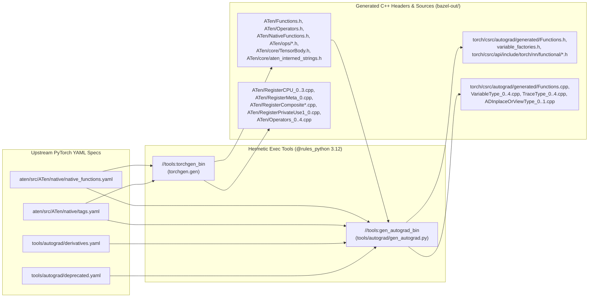

# PHASE 2: Hermetic `torchgen` Codegen, Companion CPU Modules (`@sleef`, `@ittapi`), and `@libtorch//:torch_cpu` & `:torch`

> **Status:** Planned (follows [PHASE1.md](PHASE1.md)). Brings up PyTorch's build-time Python code generators (`torchgen` and `tools/autograd/gen_autograd.py`), packages `@sleef` and `@ittapi` in `./modules/`, compiles multi-ISA CPU operator kernels (`AVX2`/`AVX512` on x86_64, `NEON`/`SVE` on arm64), and delivers `@libtorch//:torch_cpu` and `@libtorch//:torch` (`autograd`, `nn`, `jit`, `Meta`, `Lazy`, `NNAPI`, and all out-of-tree accelerator hook interfaces).

---

## 1. Goals & Scope

1. **Hermetic Build-Time Codegen (`torchgen` & `gen_autograd`):**
   - Execute `torchgen.gen` and `tools/autograd/gen_autograd.py` as Bazel actions on the `exec` platform using `@rules_python`'s hermetic Python 3.12 toolchain + `pyyaml`.
   - Zero pre-generated C++ files checked into the overlay: all ~3,200 `ATen/ops/*.h` headers, dispatcher registrations (`RegisterCPU_*.cpp`, `RegisterMeta_*.cpp`, `RegisterSparse_*.cpp`, `RegisterQuantizedCPU_*.cpp`, `RegisterBackendSelect.cpp`, `RegisterCompositeExplicitAutograd_*.cpp`, `RegisterCompositeImplicitAutograd_*.cpp`), and autograd `VariableType_*.cpp` / `Functions.cpp` are generated in the action graph.
2. **Companion Local BCR Modules (`./modules/`):**
   - **`modules/sleef/3.8.0` (`@sleef`):** Builds `libsleef` from upstream [`shibatch/sleef`](https://github.com/shibatch/sleef) across Linux, macOS, and Windows (`x86_64` SSE2/AVX/AVX2/AVX512F and `aarch64` AdvSIMD/SVE), running `mkrename` and `mkdisp` as `cfg = "exec"` host tools so cross-compilation works between any `(host, target)` pair.
   - **`modules/ittapi/3.25.5` (`@ittapi`):** Builds `libittnotify` from upstream [`intel/ittapi`](https://github.com/intel/ittapi) for `ATen/record_function` ITT instrumentation.
3. **Complete CPU & Core Runtime (`@libtorch//:torch_cpu` & `@libtorch//:torch`):**
   - Compiles `aten/src/ATen/{core,cpu,detail,functorch,metal,nnapi,native,ops,quantized}/**` and `torch/csrc/{api,autograd,DynamicTypes,Export,fx,inductor,jit,lazy,monitor,mtia,onnx,profiler/stubs,serialization,tensor,utils}/**` with `USE_PYTHON=0` (`CAFFE2_BUILD_MAIN_LIB` / `TORCH_API`).
   - Compiles all `ATen/detail/*HooksInterface.cpp` (`CUDA`, `HIP`, `MPS`, `XPU`, `HPU`, `IPU`, `MAIA`, `MTIA`, `XLA`, `PrivateUse1`) so GPU and out-of-tree accelerator plugins can register dynamically at runtime.

---

## 2. Hermetic Codegen Architecture

### 2.1 `libtorch_aten_codegen` Rule (`libtorch_codegen.bzl`)

Runs `python -m torchgen.gen` with:
- `--source-path=aten/src/ATen`
- `--install-dir=<output_dir>/aten/src/ATen`
- `--per-operator-headers`
- `--static-dispatch-backend` (omitted so dynamic dispatcher is used for all backends: CPU, CUDA, HIP, XPU, MPS, Vulkan, Meta, PrivateUse1)
- `--backend-whitelist`: Includes `CPU`, `CUDA` (or `HIP` when hipifying), `XPU`, `MPS`, `Vulkan`, `Meta`, `MkldnnCPU`, `QuantizedCPU`, `QuantizedCUDA`, `SparseCPU`, `SparseCUDA`, `SparseCsrCPU`, `SparseCsrCUDA`, `NestedTensorCPU`, `NestedTensorCUDA`, `ZeroTensor`, `CompositeExplicitAutograd`, `CompositeExplicitAutogradNonFunctional`, `CompositeImplicitAutograd`, `CompositeImplicitAutogradNestedTensor`, `BackendSelect`, `FuncTorchBatched`, `Named`, `PrivateUse1`.

> [!TIP]
> Passing the full backend whitelist to `torchgen.gen` emits `RegisterCUDA_*.cpp`, `RegisterXPU_*.cpp`, `RegisterMPS_*.cpp`, and `RegisterVulkan_*.cpp` alongside `RegisterCPU_*.cpp`. Targets that do not enable a given GPU backend simply omit that backend's `Register<Backend>_*.cpp` from their `srcs`, while `NativeFunctions.h` and `Operators.h` keep a uniform declaration signature across all platforms!

### 2.2 `libtorch_autograd_codegen` Rule (`libtorch_codegen.bzl`)

Runs `tools/autograd/gen_autograd.py` with:
- `--aten-path=aten`
- `--out-dir=<output_dir>/torch/csrc/autograd/generated`
- `--autograd-dir=tools/autograd`
- Generates `VariableType_0.cpp`..`VariableType_4.cpp`, `TraceType_0.cpp`..`TraceType_4.cpp`, `ADInplaceOrViewType_0.cpp`..`ADInplaceOrViewType_1.cpp`, `Functions.cpp`, `ViewFuncs.cpp`, and the `torch/csrc/api/include/torch/nn/functional/` C++ frontend headers.

---

## 3. CPU Vectorization & Multi-ISA Kernel Compilation (`ATen/native/cpu/`)

PyTorch's CPU kernels in `aten/src/ATen/native/cpu/*.cpp` use `CPU_CAPABILITY` dispatch (`ATen/cpu/vec/vec.h`). Each kernel source file is compiled once per target ISA capability with `-DCPU_CAPABILITY=<ISA>` and the corresponding architecture flags:

| Target Architecture | Capability Name (`-DCPU_CAPABILITY=...`) | Compiler Flags (`copts`) | Dispatched Symbol Namespace |
| :--- | :--- | :--- | :--- |
| `x86_64` (`linux_amd64`, `macos_amd64`, `windows_amd64`) | `DEFAULT` | `-msse4.2` | `at::native::DEFAULT::*` |
| `x86_64` (`linux_amd64`, `macos_amd64`, `windows_amd64`) | `AVX2` | `-mavx2`, `-mfma`, `-mf16c`, `-mbmi`, `-mbmi2` | `at::native::AVX2::*` |
| `x86_64` (`linux_amd64`, `windows_amd64`) | `AVX512` | `-mavx512f`, `-mavx512dq`, `-mavx512bw`, `-mavx512vl`, `-mfma`, `-mf16c` | `at::native::AVX512::*` |
| `aarch64` (`linux_arm64`, `macos_arm64`, `windows_arm64`) | `DEFAULT` | `-march=armv8-a+fp16+dotprod` | `at::native::DEFAULT::*` |
| `aarch64` (`linux_arm64`) | `SVE256` | `-march=armv8.2-a+sve+fp16+dotprod`, `-msve-vector-bits=256` | `at::native::SVE256::*` |

A Starlark helper macro `libtorch_cpu_kernel_library` generates the per-ISA `cc_library` targets so `DispatchStub` in `ATen/native/DispatchStub.cpp` selects the optimal kernel at runtime based on `@cpuinfo`.

---

## 4. `aten/src/ATen/Config.h` Configuration

Generated per target platform via `select()` + `expand_template`:

| Macro | Value | Notes |
| :--- | :--- | :--- |
| `AT_MKLDNN_ENABLED()` | `1` on `x86_64`, `0` on `aarch64` | Uses `@onednn` (`2.7.3`) from BCR on `x86_64`. |
| `AT_MKLDNN_ACL_ENABLED()` | `0` | ARM kernels use `@kleidiai` + `@xnnpack` + `@sleef`. |
| `AT_MKL_ENABLED()` | `0` | Uses hermetic `@eigen` + `@pocketfft` + platform BLAS (`Accelerate` on macOS). |
| `AT_POCKETFFT_ENABLED()` | `1` | Uses `@pocketfft` (`0.0.2.bcr.1`) from BCR on all 6 platforms. |
| `AT_NNPACK_ENABLED()` | `0` | Superseded by `@xnnpack`. |
| `CAFFE2_STATIC_LINK_CUDA()` | `0` | `libtorch_cuda` links dynamically or via `REGISTER_CUDA_HOOKS`. |
| `AT_BUILD_WITH_BLAS()` | `1` on macOS (`Accelerate`), `0` (or OpenBLAS) elsewhere | CPU GEMM uses `onednn` / `kleidiai` / `eigen` / `Accelerate`. |
| `AT_BUILD_WITH_LAPACK()` | `1` on macOS (`Accelerate`), `0` elsewhere | — |
| `AT_PARALLEL_OPENMP` | `1` | Uses `@openmp` (`21.1.5.bcr.3`, LLVM `libomp`) from BCR. |
| `AT_PARALLEL_NATIVE` | `0` | — |
| `AT_KLEIDIAI_ENABLED()` | `1` on `linux_arm64` & `macos_arm64`, `0` elsewhere | Uses `@kleidiai` (`0.0.0-20260506-d41219d3db`) from BCR. |
| `AT_USE_EIGEN_SPARSE()` | `1` | Uses `@eigen` from BCR. |

---

## 5. Companion Local BCR Modules (`./modules/`)

### 5.1 `modules/sleef/3.8.0` (`@sleef`)

- **Upstream Archive:** `https://github.com/shibatch/sleef/archive/refs/tags/3.8.tar.gz`
- **Build Strategy:**
  - Compiles host codegen binaries (`mkrename`, `mkrename_gnuabi`, `mkdisp`, `mkalias`) with `cfg = "exec"`.
  - Runs `genrule`s to generate `rename*.h` and `sleefsimddp.c` / `sleefsimdsp.c` dispatchers for `x86_64` (`SSE2`, `SSE4`, `AVX`, `AVX2`, `FMA4`, `AVX512F`) and `aarch64` (`ADVSIMD`, `SVE`).
  - Exposes `@sleef//:sleef` (`cc_library`) with `sleef.h`.

### 5.2 `modules/ittapi/3.25.5` (`@ittapi`)

- **Upstream Archive:** `https://github.com/intel/ittapi/archive/refs/tags/v3.25.5.tar.gz`
- **Build Strategy:**
  - Compiles `src/ittnotify/ittnotify_static.c` and `src/ittnotify/jitprofiling.c` into `@ittapi//:ittnotify` (`cc_library`), exporting `include/ittnotify.h` and `include/legacy/ittnotify.h`.

---

## 6. Verification Criteria (Phase 2 Gate)

1. **`//tests/tensor_math:tensor_math_test`:**
   - Creates CPU tensors (`torch::randn`, `torch::arange`, `torch::eye`), executes matrix multiplication (`torch::matmul`), FFT (`torch::fft::fft` via `@pocketfft`), and transcendental vector math (`torch::sin`, `torch::exp`, `torch::erf` via `@sleef`), verifying numerical accuracy across `DEFAULT`, `AVX2`/`AVX512`, and `NEON`.
2. **`//tests/autograd_nn:autograd_nn_test`:**
   - Constructs a 2-layer `torch::nn::Sequential(torch::nn::Linear(16, 32), torch::nn::Functional(torch::relu), torch::nn::Linear(32, 4))`, runs a forward pass, computes MSE loss, calls `loss.backward()`, and steps `torch::optim::Adam`, verifying non-zero gradients and decreasing loss.
3. **`//tests/torchscript_jit:torchscript_jit_test`:**
   - Compiles a TorchScript module from string (`torch::jit::compile("def forward(self, x, y): return torch.relu(x @ y + 1.0)")`), runs inference, serializes it to an `std::stringstream` (`save`), reloads it (`load`), and verifies identical outputs.
4. **`//tests/accelerator_hooks:accelerator_hooks_test`:**
   - Exercises `c10::kMeta` zero-storage shape propagation (`torch::empty({1024, 1024}, torch::kMeta)`), `c10::register_privateuse1_backend("my_npu")`, and verifies `ATen/detail/*HooksInterface` registration hooks for `CUDA`, `HIP`, `XPU`, `MPS`, `HPU`, `MTIA`, and `XLA`.

