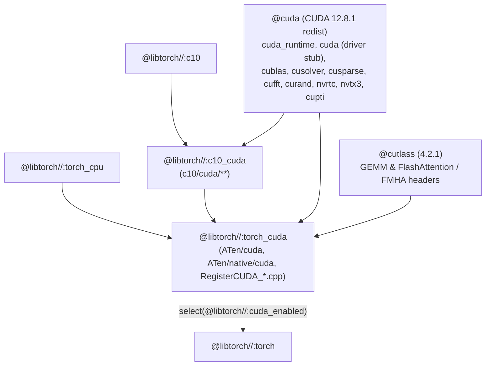

# PHASE 3: NVIDIA CUDA Backend (`@libtorch//:c10_cuda` & `@libtorch//:torch_cuda`)

> **Status:** Planned (follows [PHASE2.md](PHASE2.md)). Compiles PyTorch's full CUDA stack (`c10/cuda`, `ATen/cuda`, `ATen/native/cuda`, `ATen/native/transformers/cuda`, `ATen/native/sparse/cuda`, `ATen/native/quantized/cuda`, and `torch/csrc/cuda`) using `@rules_cuda` (`clang -x cu`) + `@llvm` (`NVPTX` backend) + `CUDA 12.8.1` redistributable components across `linux-x86_64`, `linux-sbsa` (`aarch64`), and `windows-x86_64`.

---

## 1. Architecture & Target Split



To mirror upstream LibTorch and keep compile/link units manageable (especially on Windows where PE/COFF limits a single DLL to 65,535 exported symbols), the CUDA backend is split into:

| Target | Shared Target | Upstream Equivalent | Contents |
| :--- | :--- | :--- | :--- |
| `@libtorch//:c10_cuda` | `@libtorch//:c10_cuda_shared` | `libc10_cuda.{so,dll}` | `c10/cuda/*.cpp`, `c10/cuda/*.cu` (`CUDAStream.cpp`, `CUDACachingAllocator.cpp`, `CUDAFunctions.cpp`, `CUDAException.cpp`, `driver_api.cpp`, `impl/CUDAGuardImpl.cpp`, `impl/CUDATest.cpp`). |
| `@libtorch//:aten_cuda_kernels` | — (internal `cuda_library`) | `ATen_CUDA_CU` | Device `.cu` translation units under `aten/src/ATen/cuda/**` and `aten/src/ATen/native/{cuda,nested,quantized/cuda,sparse/cuda,transformers/cuda,ufunc}/**/*.cu`. |
| `@libtorch//:torch_cuda` | `@libtorch//:torch_cuda_shared` | `libtorch_cuda.{so,dll}` | Host `.cpp` files in `aten/src/ATen/cuda/**` and `aten/src/ATen/native/cuda/**`, `RegisterCUDA_0.cpp`, `RegisterNestedTensorCUDA_0.cpp`, `RegisterSparseCUDA_0.cpp`, `RegisterSparseCsrCUDA_0.cpp`, `RegisterQuantizedCUDA_0.cpp`, `ATen/cuda/detail/CUDAHooks.cpp`, and `:aten_cuda_kernels`. |

---

## 2. CUDA Configuration & Redistributable Components (`MODULE.bazel` & `.bazelrc`)

### 2.1 `cuda.redist_json` Component Set (`12.8.1`)

In root `MODULE.bazel`, `cuda.redist_json` declares the full set of CUDA 12.8.1 deliverables required by `c10_cuda` and `torch_cuda`:

| Component (`rules_cuda` name) | NVIDIA Deliverable | Target in `@cuda//` | Usage in `@libtorch` |
| :--- | :--- | :--- | :--- |
| `cccl` | `cuda_cccl` | `@cuda//:cub`, `@cuda//:thrust`, `@cuda//:libcudacxx` | `ATen/cuda/cub.cuh`, `ATen/native/cuda/Sorting.cu`, Thrust/CUB reductions & scans. |
| `cudart` | `cuda_cudart` | `@cuda//:cuda_runtime`, `@cuda//:cuda` | `libcudart.{so,lib}` runtime + `stubs/libcuda.so` / `cuda.lib` driver stub (`c10/cuda/driver_api.cpp`). |
| `nvcc` | `cuda_nvcc` | `@cuda//:compiler_root`, `@cuda//:nvptxcompiler` | `ptxas`, `fatbinary`, `bin2c`, `nvlink`, `libdevice.10.bc`, and `<cuda_fp16.h>` / `<cuda_bf16.h>` / `<cuda_fp8.h>`. |
| `cublas` | `libcublas` | `@cuda//:cublas` | `libcublas.{so,lib}` + `libcublasLt.{so,lib}` (`ATen/cuda/CUDABlas.cpp`). |
| `cusolver` | `libcusolver` | `@cuda//:cusolver` | `ATen/native/BatchLinearAlgebraKernel.cu`, `linalg` SVD/QR/Cholesky/Eigh. |
| `cusparse` | `libcusparse` | `@cuda//:cusparse` | `ATen/native/sparse/cuda/*`. |
| `cufft` | `libcufft` | `@cuda//:cufft` | `ATen/native/cuda/SpectralOps.cu`. |
| `curand` | `libcurand` | `@cuda//:curand` | `ATen/cuda/CUDAGeneratorImpl.cpp`, Philox device RNG headers (`curand_kernel.h`). |
| `nvrtc` | `cuda_nvrtc` | `@cuda//:nvrtc` | `ATen/cuda/nvrtc_stub/ATenNVRTC.cpp` (Jiterator runtime kernel compilation). |
| `nvtx` | `cuda_nvtx` | `@cuda//:nvtx3` | `<nvtx3/nvToolsExt.h>` headers for `torch/csrc/cuda/nvtx.cpp` and profiler ranges. |
| `cupti` | `cuda_cupti` | `@cuda//:cupti` | `<cupti.h>` for Kineto GPU activity/trace collection. |

### 2.2 Clang CUDA Compiler Flags (`.bazelrc` & `libtorch_cuda.bzl`)

When compiling `.cu` files with `@llvm` Clang 21 (`--@rules_cuda//cuda:compiler=clang`):

- **GPU Architectures (`--@rules_cuda//cuda:archs`):**
  - Default: `sm_70,sm_75,sm_80,sm_86,sm_89,sm_90` (covering Volta V100, Turing T4, Ampere A100/RTX 30xx, Ada RTX 40xx/L4, and Hopper H100).
- **Clang CUDA Device/Host Flags:**
  - `-std=c++20`
  - `-stdlib=libc++` (on Linux and macOS; MinGW `libc++` on Windows)
  - `-D_ALLOW_UNSUPPORTED_LIBCPP`
  - `-D__NV_NO_HOST_COMPILER_CHECK=1` (allows Clang 21 with CUDA 12.8 headers)
  - `--expt-relaxed-constexpr`-equivalent behavior (native in Clang CUDA: `constexpr` host functions are implicitly callable from `__device__` when relaxed constexpr is enabled or via `-fcuda-allow-variadic-functions`).
  - `-Wno-unknown-cuda-version` (silences Clang's version warning if a newer CUDA point release is used).

---

## 3. Generated Headers for CUDA

### 3.1 `c10/cuda/impl/cuda_cmake_macros.h`

Generated from `c10/cuda/impl/cuda_cmake_macros.h.in`:

```c
#pragma once
/* #undef C10_CUDA_BUILD_SHARED_LIBS */
```

### 3.2 `aten/src/ATen/cuda/CUDAConfig.h`

Generated from `aten/src/ATen/cuda/CUDAConfig.h.in`:

```c
#pragma once
#define AT_CUDNN_ENABLED() 0
#define AT_CUSPARSELT_ENABLED() 0
#define AT_HIPSPARSELT_ENABLED() 0
#define AT_ROCM_ENABLED() 0
#define AT_MAGMA_ENABLED() 0
#define NVCC_FLAGS_EXTRA "-gencode=arch=compute_80,code=sm_80"
```

> [!NOTE]
> `AT_CUDNN_ENABLED()` defaults to `0` so `libtorch_cuda` has zero proprietary redistributable dependency outside the standard CUDA toolkit; all convolutions, batchnorms, SDPA/FlashAttention (`@cutlass`), and linear algebra ops run via native ATen CUDA / cuBLASLt / CUTLASS / cuSOLVER kernels. An optional `--@libtorch//:enable_cudnn` flag can enable cuDNN when `@cudnn_frontend` + cuDNN redist are configured.

---

## 4. Link-Time Driver Stubs & Runtime Dynamic Loading

PyTorch's CUDA backend is specifically architected to allow binaries linked against `libtorch_cuda` to start and run CPU code on machines **without** an NVIDIA GPU or driver installed:

1. **`c10/cuda/driver_api.cpp`:** Uses `dlopen("libcuda.so.1")` on Linux and `LoadLibraryA("nvcuda.dll")` on Windows to resolve `cuInit`, `cuDriverGetVersion`, `cuMemAddressReserve`, etc. lazily when a CUDA tensor or stream is actually created.
2. **`ATen/cuda/nvrtc_stub/ATenNVRTC.cpp`:** Lazily loads `libnvrtc.so` / `nvrtc64_*.dll` only when Jiterator compiles a dynamic kernel.
3. **`ATen/detail/CUDAHooksInterface.cpp` & `ATen/cuda/detail/CUDAHooks.cpp`:**
   - `REGISTER_CUDA_HOOKS(CUDAHooks)` registers the CUDA hook implementation at static initialization time (`alwayslink = True` on the registration translation unit in `:torch_cuda`).
   - Calling `torch::cuda::is_available()` invokes `c10::cuda::device_count()`, which calls `cudaGetDeviceCount()` in `libcudart`, returning `0` (and `false`) cleanly when no NVIDIA driver is present on the host.

---

## 5. Verification Criteria (Phase 3 Gate)

1. **`//tests/cuda_dispatch:cuda_dispatch_test`:**
   - Links `@libtorch//:torch` (which pulls in `:torch_cuda` on `linux-amd64`, `linux-arm64`, and `windows-amd64`).
   - Verifies that `at::hasCUDA()` returns `true` (confirming `CUDAHooks` and `RegisterCUDA` are linked and registered with the dispatcher).
   - Verifies that `torch::cuda::is_available()` and `torch::cuda::device_count()` execute without crashing on headless/CPU-only Linux CI runners.
   - When `torch::cuda::is_available()` is `true` (on a machine with an NVIDIA GPU), allocates tensors on `torch::kCUDA`, runs `torch::matmul` (cuBLAS), `torch::linalg::svd` (cuSOLVER), `torch::fft::fft` (cuFFT), and `at::native::scaled_dot_product_efficient_attention` (CUTLASS), and verifies results match `torch::kCPU`.
2. **Cross-Compilation Verification:**
   - `bazel build --config=libtorch --platforms=@llvm//platforms:linux_amd64_gnu.2.34`
   - `bazel build --config=libtorch --platforms=@llvm//platforms:linux_arm64_gnu.2.34`
   - `bazel build --config=libtorch --platforms=@llvm//platforms:windows_amd64`
   - All three build `@libtorch//:c10_cuda` and `@libtorch//:torch_cuda` cleanly from a Linux CI host.

