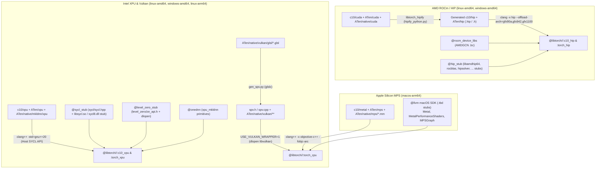

# PHASE 4: Multi-Vendor GPU Backends — AMD (`ROCm/HIP`), Intel (`XPU` & `Vulkan`), Apple (`MPS/Metal`), and Mobile (`NNAPI`)

> **Status:** In progress (follows [PHASE3.md](PHASE3.md)). Extends `@libtorch` beyond NVIDIA CUDA to build and cross-compile **AMD ROCm/HIP** (`:c10_hip`, `:torch_hip`), **Intel Data Center & Arc GPUs** (`:c10_xpu`, `:torch_xpu` + `Vulkan` compute), and **Apple Silicon GPUs** (`MPS` / `Metal` in `:torch_cpu` on `macos_arm64`) using `hermetic-llvm` Clang and lazily-forwarding library shim modules in `./modules/`.

## 0. Progress and Decisions (2026-10-26)

| Backend | State |
| :--- | :--- |
| Vulkan | Done: `//tests/vulkan_dispatch` passes on `linux_x86_64` (on a real GPU) and cross-builds for `windows_amd64`. |
| Apple MPS | Done: `//tests/mps_dispatch` cross-builds for `macos_arm64`. |
| AMD ROCm/HIP | Done (`--config=rocm`, `linux_x86_64`): `//tests/hip_smoke` and `//tests/hip_dispatch` pass without an AMD GPU; not yet run on one. |
| Intel XPU | Done, runtime only (`--config=xpu`, `linux_x86_64`): `//tests/xpu_dispatch` passes; never finds a device (see 3.4). |

Decisions that supersede sections 2 and 3:

- **ROCm 7.14.1** (`therock-7.14.1` tags of `ROCm/rocm-systems`, `ROCm/rocm-libraries` and `ROCm/llvm-project`), not 6.3.2: PyTorch 2.14.1 has `ROCM_VERSION >= 71400` code paths. AMD's prebuilt TheRock tarballs (2.7-9.5 GB per GPU family, ROCm 10.x only on the stable channel) were rejected in favour of building from these sources.
- **Three modules** instead of `@rocm_device_libs` + `@hip_stub`, because each module has one source archive:
  - `@rocm-device-libs` (`ROCm/llvm-project` `amd/device-libs`): the AMDGPU bitcode (`ocml`, `ockl`, `oclc_*` for every GPU, ...), compiled per source file by the toolchain's Clang, and linked by a small `utils/link-builtins` tool (`llvm-link` + `prepare-builtins`) because `@llvm`'s patched `llvm-link` treats its own `argv[0]` as an input file.
  - `@hip-stub` (`ROCm/rocm-systems`): HIP and AMD SMI headers, shims of `libamdhip64.so.7` and `libhiprtc.so.7`, and `:hip_sdk`, a ROCm directory for Clang (`--rocm-path=$(execpath @hip-stub//:hip_sdk) -B$(execpath @hip-stub//:hip_sdk)/bin`). Upstream Clang 23 uses the new offload driver, whose tools (`clang-linker-wrapper`, `clang-offload-bundler`, `llvm-offload-binary`, `lld`) the prebuilt `@llvm` toolchain lacks; `:hip_sdk` builds them from `@llvm-project`.
  - `@rocm-libraries-stub` (`ROCm/rocm-libraries`): rocPRIM, hipCUB, rocThrust and the rocRAND/hipRAND device APIs (header-only), and headers plus shims of rocBLAS, rocSOLVER, hipBLAS, hipBLASLt, hipSOLVER, hipSPARSE, hipFFT and MIOpen (which a ROCm build always uses: `aten/src/ATen/native/miopen` is enabled by `AT_ROCM_ENABLED()`). `@hip-stub` also provides `rocm-core/rocm_version.h` and a `libroctx64.so.4` shim (the profiler's annotations).
- **Shims instead of link-time stubs**: each shim (`@hip-stub//bazel:gen_shim.py`) has the real library's SONAME and symbol versions, and forwards every call to the real library (found under `ROCM_PATH`, `/opt/rocm` or `LD_LIBRARY_PATH`) on first use, so one binary runs kernels on AMD GPUs and reports zero devices elsewhere. Linux x86_64 only for now (Windows needs DLL shims).
- `//tests/hip_smoke` verifies the toolchain: kernels for `gfx90a`, `gfx942` and `gfx1100` embedded in one binary, and every library shim reporting errors without ROCm.
- **`--@libtorch//:gpu=cuda|rocm|xpu|none`** (default `cuda`; `--config=rocm`, `--config=xpu`) replaces `enable_cuda`/`enable_rocm`/`enable_xpu`: one discrete GPU backend per build; `--@libtorch//:rocm_archs` (default `gfx90a,gfx942,gfx1100`) selects the GPUs. `tools/libtorch_hipify.py` hipifies the CUDA backend in one action into a header tree (taking precedence over the original headers with `-I`) and source trees for `:c10_hip`, `:torch_hip_kernels` (`-x hip`) and `:torch_hip`. `:torch_cpu` is the same for every GPU backend (no `USE_ROCM`, as it has no `USE_CUDA`).
- `rocm/libtorch_hip_compat.h` is force-included into the ROCm sources for what upstream gets from libstdc++ but not from libc++: libc++'s `__config` before HIP's `__noinline__` macro, and HIP's `__device__ memcpy`/`memset` in namespace `std`.
- **ROCm and CUDA are mutually exclusive** for `@libtorch`: `hipify` rewrites ~150 existing files in place (e.g. `torch/headeronly/macros/Macros.h`, `torch/csrc/cuda/*`) in addition to generating ~700 `hip/` files, and `torch_cpu` itself is compiled with `USE_ROCM`. A ROCm build therefore needs its own build configuration on `linux_x86_64`.

---

## 1. Overview of Multi-Vendor GPU Architecture

---

## 2. AMD GPUs: ROCm / HIP (`@libtorch//:c10_hip` & `@libtorch//:torch_hip`)

### 2.1 Build-Time HIPIFY Rule (`libtorch_hipify`)

Upstream PyTorch does not maintain a duplicate tree of `.hip` files in git; instead, it runs `torch/utils/hipify/hipify_python.py` during the build to translate `c10/cuda/**`, `aten/src/ATen/cuda/**`, `aten/src/ATen/native/cuda/**`, and `torch/csrc/cuda/**` into `c10/hip/**`, `aten/src/ATen/hip/**`, `aten/src/ATen/native/hip/**`, and `torch/csrc/hip/**`.

- **Bazel Rule (`libtorch_hipify` in `libtorch_hip.bzl`):**
  - Runs `hipify_python.py` on the `exec` platform (`cfg = "exec"`) via `@rules_python`.
  - Inputs: `c10/cuda/**`, `aten/src/ATen/cuda/**`, `aten/src/ATen/native/cuda/**`.
  - Outputs: A tree artifact (or explicit declared file list) of hipified `.hip`, `.cpp`, and `.h` / `.cuh` files under `bazel-out/<cfg>/bin/external/libtorch+/hipified/`.
  - `torchgen` generates `RegisterHIP_0.cpp`, `RegisterSparseHIP_0.cpp`, `RegisterSparseCsrHIP_0.cpp`, `RegisterNestedTensorHIP_0.cpp`, and `RegisterQuantizedHIP_0.cpp`.

### 2.2 Local BCR Module: `modules/rocm-device-libs/6.3.2` (`@rocm_device_libs`)

When Clang compiles HIP device code (`clang -x hip --offload-arch=gfx90a`), it looks for AMD's open-source device bitcode libraries (`ocml.bc`, `ockl.bc`, `oclc_daz_opt_on.bc`, `oclc_daz_opt_off.bc`, `oclc_unsafe_math_on.bc`, `oclc_unsafe_math_off.bc`, `oclc_finite_only_on.bc`, `oclc_finite_only_off.bc`, `oclc_correctly_rounded_sqrt_on.bc`, `oclc_correctly_rounded_sqrt_off.bc`, `oclc_wavefrontsize64_on.bc`, `oclc_wavefrontsize64_off.bc`, `oclc_abi_version_500.bc`, `oclc_isa_version_*.bc`) under `--rocm-device-lib-path=...`.

- **Source Archive:** `https://github.com/ROCm/llvm-project` (or standalone `ROCm-Device-Libs` release tarball `rocm-6.3.2`).
- **Build Strategy:**
  - Compiles the OpenCL/LLVM-IR device sources to `.bc` bitcode files using `@llvm`'s `clang` (`-x cl -Xclang -finclude-default-header --target=amdgcn-amd-amdhsa -emit-llvm -c`) and `llvm-link`.
  - 100% hermetic and target-OS independent (bitcode is pure `amdgcn-amd-amdhsa` LLVM IR).

### 2.3 Local BCR Module: `modules/hip-stub/6.3.2` (`@hip_stub`)

Analogous to `modules/libglvnd/1.7.0` in `qt_bazel_workspace`, `@hip_stub` provides the open-source ROCm headers (`<hip/hip_runtime.h>`, `<hip/hip_fp16.h>`, `<hip/hip_bfloat16.h>`, `<hiprtc.h>`, `<rocblas/rocblas.h>`, `<hipblaslt/hipblaslt.h>`, `<hipsparse/hipsparse.h>`, `<hipsolver/hipsolver.h>`, `<hipfft/hipfft.h>`, `<hiprand/hiprand.h>`, `<miopen/miopen.h>`) and builds link-time symbol-stub shared libraries / Windows `.def` import libraries:

| Target | Linux Stub DSO (`SONAME`) | Windows Import Lib (`DLL`) | Symbols Stubbed |
| :--- | :--- | :--- | :--- |
| `@hip_stub//:amdhip64` | `libamdhip64.so.6` | `amdhip64_6.dll` | `hipInit`, `hipGetDeviceCount`, `hipMalloc`, `hipLaunchKernel`, `__hipPushCallConfiguration`, `__hipRegisterFatBinary`, ... |
| `@hip_stub//:hiprtc` | `libhiprtc.so.6` | `hiprtc0603.dll` | `hiprtcCreateProgram`, `hiprtcCompileProgram`, `hiprtcGetCode`, ... |
| `@hip_stub//:rocblas` | `librocblas.so.4` | `rocblas.dll` | `rocblas_create_handle`, `rocblas_sgemm`, `rocblas_dgemm`, `rocblas_gemm_ex`, ... |
| `@hip_stub//:hipblaslt` | `libhipblaslt.so.0` | `hipblaslt.dll` | `hipblasLtCreate`, `hipblasLtMatmul`, ... |
| `@hip_stub//:hipsolver` | `libhipsolver.so.0` | `hipsolver.dll` | `hipsolverDnCreate`, `hipsolverDnSgesvd`, `hipsolverDnSpotrf`, ... |
| `@hip_stub//:hipsparse` | `libhipsparse.so.1` | `hipsparse.dll` | `hipsparseCreate`, `hipsparseSpMM`, ... |
| `@hip_stub//:hipfft` | `libhipfft.so.0` | `hipfft.dll` | `hipfftPlanMany`, `hipfftExecC2C`, ... |
| `@hip_stub//:hiprand` | `libhiprand.so.1` | `hiprand.dll` | `hiprandCreateGenerator`, `hiprandGenerateNormal`, ... |

### 2.4 Clang Native HIP Compilation Flags (`libtorch_hip.bzl`)

- `-x hip`
- `--offload-arch=gfx90a --offload-arch=gfx942 --offload-arch=gfx1100` (configurable via `--@libtorch//:rocm_archs`)
- `--rocm-device-lib-path=$(location @rocm_device_libs//:bitcode_dir)`
- `-D__HIP_PLATFORM_AMD__=1 -DUSE_ROCM=1`
- `-fno-gpu-rdc` (matches upstream PyTorch's non-RDC translation unit compilation)

---

## 3. Intel GPUs: `XPU` (`@libtorch//:c10_xpu` & `:torch_xpu`) and `Vulkan` Compute

### 3.1 How In-Tree PyTorch 2.14.1 Implements `XPU`

An inspection of `pytorch/pytorch@v2.14.1` reveals a crucial architectural property:

1. **All in-tree `XPU` files in `pytorch/pytorch` are pure host C++20 `.cpp` files:**
   - `c10/xpu/{PeerToPeerAccess,XPUCachingAllocator,XPUFunctions,XPUStream,impl/XPUGuardImpl}.cpp`
   - `aten/src/ATen/xpu/{CachingHostAllocator,EmptyTensor,MemPool,XPUContext,XPUGeneratorImpl,XPUGraph,XPUScaledBlas,detail/LazyLevelZero,detail/XPUHooks}.cpp`
   - `aten/src/ATen/native/mkldnn/xpu/{Attention,Blas,Conv,FusionUtils,Linear,RNN,ScaledBlas,qconv,qlinear,detail/*}.cpp`
   - `aten/src/ATen/native/transformers/xpu/{attention,attention_backward,sdp_utils}.cpp`
   - `torch/csrc/xpu/{Event,Module,Stream}.cpp`
2. **None of these files contain device kernel syntax requiring `icpx -fsycl`!** They only include `<sycl/sycl.hpp>` to manage `sycl::device`, `sycl::context`, `sycl::queue`, `sycl::event`, and USM memory (`sycl::malloc_device`, `sycl::malloc_host`, `sycl::free`), call `onednn::sycl_interop` for GEMM/Conv/Attention primitives, and use `aten/src/ATen/xpu/detail/LazyLevelZero.cpp` (which already uses `dlopen("libze_loader.so")` / `LoadLibrary("ze_loader.dll")`!).

### 3.2 Local BCR Modules: `modules/sycl-stub/2025.0.0` & `modules/level-zero-stub/1.20.2`

- **`@level_zero_stub` (`modules/level-zero-stub/1.20.2`):**
  - Pinned to upstream [`oneapi-src/level-zero@v1.20.2`](https://github.com/oneapi-src/level-zero/archive/refs/tags/v1.20.2.tar.gz).
  - Exports `<level_zero/ze_api.h>` headers required by `aten/src/ATen/xpu/level_zero_stub/ATenLevelZero.h` (plus an optional `libze_loader` stub DSO).
- **`@sycl_stub` (`modules/sycl-stub/2025.0.0`):**
  - Provides the standard C++20 `<sycl/sycl.hpp>` host runtime header surface (`sycl::device`, `sycl::platform`, `sycl::context`, `sycl::queue`, `sycl::event`, `sycl::aspect`, `sycl::info::*`, `sycl::property_list`, `sycl::ext::oneapi::*`, USM allocation functions) compilable with standard Clang 21 (`@llvm`), backed by a link-time `libsycl.so.8` / `sycl8.dll` stub library that returns 0 platforms when no Intel oneAPI runtime is installed and forwards to the host's SYCL/UR runtime when present.
- With `@sycl_stub`, `@level_zero_stub`, and `@onednn`, `@libtorch//:c10_xpu` and `@libtorch//:torch_xpu` compile 100% hermetically with `@llvm` Clang 21 on `linux-amd64` and `windows-amd64`!

### 3.3 Cross-Vendor Vulkan Compute Backend (`USE_VULKAN=1`)

In addition to `XPU`, PyTorch includes a full **Vulkan compute backend** (`c10::kVulkan`) in `aten/src/ATen/vulkan/**` and `aten/src/ATen/native/vulkan/**` that executes compute shaders on Intel Arc/iGPU, AMD Radeon, NVIDIA, and mobile GPUs:

- **Shader Codegen (`libtorch_vulkan_spv_codegen`):**
  - Runs `aten/src/ATen/native/vulkan/gen_spv.py` at build time using `@glslang` / `glslc` (from BCR) to compile all `aten/src/ATen/native/vulkan/glsl/*.glsl` compute shaders into `spv.h` and `spv.cpp`.
- **Zero-Driver Link Dependency (`USE_VULKAN_WRAPPER=1`):**
  - PyTorch's `aten/src/ATen/native/vulkan/api/vk_api.h` supports `-DUSE_VULKAN_WRAPPER=1`, which uses `aten/src/ATen/native/vulkan/wrapper/ vulkan_wrapper.cpp` (`dlopen("libvulkan.so.1")` on Linux, `LoadLibraryA("vulkan-1.dll")` on Windows) together with `@vulkan_headers` (`1.4.349` from BCR) and `@vulkan_memory_allocator`!
  - Thus `USE_VULKAN=1` requires **no system `libvulkan.so` at link time** and works out-of-the-box on Linux and Windows.

### 3.4 XPU Scope (decided 2026-10-26)

The in-tree XPU sources are runtime plumbing: nearly all XPU kernels live in the separate `torch-xpu-ops` repository (SYCL device code), and the in-tree oneDNN-based operators (`aten/src/ATen/native/mkldnn/xpu`, `native/transformers/xpu`) need oneDNN's SYCL GPU runtime, which needs a `-fsycl` compiler that upstream Clang does not provide. XPU is therefore limited to `:c10_xpu` and `:torch_xpu` (`aten/src/ATen/xpu`, and AOTInductor's XPU shim and runner):

- `@sycl-stub` (intel/llvm `v7.2.0`, oneAPI 2026.2: `SYCL_COMPILER_VERSION=20260200`): the SYCL and Unified Runtime API headers (compiled as host C++, without `-fsycl`, as upstream compiles these sources), and a `libsycl.so.9` stub. Intel's `libsycl` is built for libstdc++, and its C++ API passes `std::string`, `std::vector` and `std::shared_ptr`, so libc++-built code cannot call it: unlike the ROCm shims, the stub never loads the real library. `sycl::platform::get_platforms()` returns no platforms (and `sycl::exception` works); every other function aborts (`bazel/sycl_symbols.bzl`). So `at::hasXPU()` holds and `torch::xpu::device_count()` is always 0, even with an Intel GPU and oneAPI installed.
- `@opencl-headers` (`v2025.07.22`, as DPC++ pins) and `@level-zero` (`v1.35.0`, headers only: `ATen/xpu/detail/LazyLevelZero.cpp` loads the loader at runtime).
- An XPU that runs on Intel GPUs would need intel/llvm's SYCL runtime and Unified Runtime built from source against libc++ (for memory and copies only), and its SYCL compiler for `torch-xpu-ops` (for operators).

---

## 4. Apple Silicon GPUs: `MPS` (`macos_arm64`)

When targeting `@platforms//os:macos` + `@platforms//cpu:aarch64` (`@libtorch//:mps_enabled`):

- **Sources Compiled into `@libtorch//:torch_cpu`:**
  - `aten/src/ATen/mps/*.mm`, `aten/src/ATen/mps/*.cpp` (`MPSAllocator.mm`, `MPSDevice.mm`, `MPSEvent.mm`, `MPSFallback.mm`, `MPSGeneratorImpl.mm`, `MPSGuardImpl.mm`, `MPSHooks.mm`, `MPSProfiler.mm`, `MPSStream.mm`, `IndexKernels.cpp`)
  - `aten/src/ATen/native/mps/*.mm`, `aten/src/ATen/native/mps/operations/*.mm`, `aten/src/ATen/native/mps/kernels/*.metal`
  - `torchgen`-generated `RegisterMPS_0.cpp`
- **Metal Kernel Embedding:**
  - Upstream PyTorch 2.14.1 embeds `aten/src/ATen/native/mps/kernels/*.metal` shader sources as C++ string literals via `torchgen/gen_mps_shaders.py` (or compiles them at runtime via `[MTLDevice newLibraryWithSource:options:error:]`), so **no proprietary Xcode `metal` / `metallib` CLI binary is required** to cross-compile `macos_arm64` from a Linux CI host!
- **Compiler & Linker Flags:**
  - `copts = ["-x", "objective-c++", "-fobjc-arc", "-DUSE_MPS=1"]` for `.mm` sources.
  - `linkopts = ["-framework", "Metal", "-framework", "MetalPerformanceShaders", "-framework", "MetalPerformanceShadersGraph", "-framework", "Foundation", "-framework", "CoreFoundation", "-framework", "Accelerate", "-framework", "IOSurface"]` (all provided by `@llvm`'s macOS SDK `.tbd` stubs configured in `MODULE.bazel`).

---

## 5. Verification Criteria (Phase 4 Gate)

1. **AMD ROCm/HIP (`//tests/hip_dispatch:hip_dispatch_test`):**
   - Links `@libtorch//:c10_hip` and `@libtorch//:torch_hip` on `linux-amd64` and `windows-amd64`.
   - Verifies `at::hasHIP()` and `c10::hip::device_count()` (gracefully returning `0` when stubbed on CPU CI runners, and executing hipified kernels on AMD GPUs).
2. **Intel XPU (`//tests/xpu_dispatch:xpu_dispatch_test`):**
   - Links `@libtorch//:c10_xpu` and `@libtorch//:torch_xpu` on `linux-amd64` and `windows-amd64`.
   - Verifies `at::hasXPU()` returns `true` and `c10::xpu::device_count()` gracefully returns `0` when no Intel Level Zero / SYCL device is present.
3. **Vulkan Compute (`//tests/vulkan_dispatch:vulkan_dispatch_test`):**
   - Verifies `at::vulkan::is_available()` on Linux and Windows (running compute shaders if a Vulkan ICD such as Intel Anvil, AMD RADV, NVIDIA, or Lavapipe software ICD is present, and cleanly returning `false` otherwise).
4. **Apple Silicon MPS (`//tests/mps_dispatch:mps_dispatch_test`):**
   - Cross-compiles for `macos_arm64` from Linux CI and runs natively on `macos-15` (`darwin-arm64`) GitHub Actions runners, verifying `at::hasMPS()` and executing tensor addition / `matmul` on `torch::kMPS` when Metal is available on the runner.

